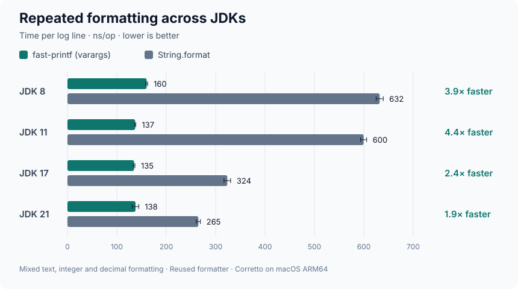

# fast-printf

[](https://github.com/YuyuZha0/fast-printf/actions/workflows/maven.yml)
[](https://codecov.io/github/YuyuZha0/fast-printf)
[](https://search.maven.org/artifact/io.github.yuyuzha0/fast-printf)
[](LICENSE)

Fast, reusable `printf` formatting for Java 8+. **Compile a format once, then reuse it.**

```java
FastPrintf format = FastPrintf.compile("User %s (id=%d) scored %.2f");
String result = format.format("Alice", 42, 99.5);
// User Alice (id=42) scored 99.50
```

- **Built for repeated formatting:** reusable, thread-safe formatters with low allocation overhead.
- **Familiar printf syntax:** numbers, text, padding, precision, and date/time patterns.
- **Modern floating-point conversion on Java 8+:** backported OpenJDK Schubfach conversion and decimal formatting for `%f`, `%e`, and `%g`.
- **Flexible arguments:** convenient varargs, primitive `Args` methods that avoid boxing, and a fixed single-argument container.
- **Optional Jackson 2 integration:** format `JsonNode` values or annotate JSON properties with `@PrintfFormat`.
- **No required runtime dependencies:** core formatting works without Jackson.

[Get started](#get-started) · [Performance](#performance) · [Usage](#usage) · [Jackson](#jackson-integration) · [Format reference](#format-reference)

## Get started

**Maven**

```xml
<dependency>
    <groupId>io.github.yuyuzha0</groupId>
    <artifactId>fast-printf</artifactId>
    <version>1.2.16</version>
</dependency>
```

**Gradle**

```groovy
implementation 'io.github.yuyuzha0:fast-printf:1.2.16'
```

Keep the compiled formatter in a field and reuse it:

```java
import io.fastprintf.FastPrintf;

public class Example {
    private static final FastPrintf FORMAT =
            FastPrintf.compile("User %s (id=%d) scored %.2f");

    public static void main(String[] args) {
        System.out.println(FORMAT.format("Alice", 42, 99.5));
        // User Alice (id=42) scored 99.50
    }
}
```

## Performance

fast-printf avoids parsing the pattern on every call. It is intended for repeated formatting in
logging, text serialization, and other hot paths.

Floating-point formatting uses a backport of OpenJDK's Schubfach-based conversion and decimal
rounding support. This brings the newer conversion algorithm to Java 8+ without requiring a JVM
upgrade; `%f`, `%e`, and `%g` apply the requested precision to the converted decimal value.



In this run, fast-printf was **1.9–4.4× faster** than `String.format` across JDK 8–21.
On JDK 21, it allocated **696 B/op versus 1,280 B/op** — about **46% less**.

Measured with [CommonUsageBenchmark](src/test/java/io/fastprintf/benchmark/CommonUsageBenchmark.java)
using `[%s] %s id=%d latency=%.3fms`, rotating input values, and a reused fast-printf formatter.
Both implementations receive the same format string. These results describe this workload;
measure your own patterns and argument types before choosing a tuning option.

<details>
<summary>Benchmark environment and reproduction</summary>

Measured on macOS ARM64 with Corretto JDK 8, 11, 17, and 21, JMH 1.37, two forks,
three 1-second warmups, four 1-second measurements, a 256 MB heap, and the GC profiler.
All JDKs use JMH's full blackhole mode and an English/US locale.

From a checkout, using the JDK you want to measure:

```sh
mvn -q test-compile dependency:build-classpath -DincludeScope=test \
    -Dmdep.outputFile=target/benchmark-classpath.txt
java -Djmh.blackhole.autoDetect=false \
    -cp "target/classes:target/test-classes:$(cat target/benchmark-classpath.txt)" \
    org.openjdk.jmh.Main 'CommonUsageBenchmark.(fastPrintfVarargs|jdkPrintf)' \
    -f 2 -wi 3 -i 4 -w 1s -r 1s -prof gc \
    -jvmArgs "-Xms256m -Xmx256m -Duser.language=en -Duser.country=US -Djmh.blackhole.autoDetect=false"
```

</details>

## Usage

### Choose how to supply arguments

Varargs are the simplest option:

```java
FastPrintf format = FastPrintf.compile("%s: %d items, total %.2f");
String result = format.format("order", 3, 12.5);
// order: 3 items, total 12.50
```

Use `Args` when building arguments incrementally or avoiding primitive boxing:

```java
import io.fastprintf.Args;

Args args = Args.create()
        .putString("order")
        .putInt(3)
        .putDouble(12.5);
String result = format.format(args);
```

Use `Args.of(values)` to expand an array or iterable into arguments. Use `Args.exactlyOne(value)`
to pass an array, iterable, or other value as **one argument**:

```java
FastPrintf listFormat = FastPrintf.compile("Values: %s");
String result = listFormat.format(Args.exactlyOne(new int[] {1, 2, 3}));
// Values: [1, 2, 3]
```

`Args.exactlyOne` accepts null and returns a reusable container that cannot be appended to.
Argument containers retain references to their values; they do not copy mutable objects.

### Write into an existing buffer

```java
FastPrintf format = FastPrintf.compile("id=%d");
StringBuilder output = new StringBuilder("record: ");
format.format(output, Args.exactlyOne(42));
// output contains "record: id=42"
```

The same overload accepts any `Appendable`, including a `Writer`.

### Format dates and times

```java
import java.time.LocalDate;

FastPrintf dateFormat = FastPrintf.compile("Date: %t{yyyy-MM-dd}");
String result = dateFormat.format(LocalDate.of(2026, 10, 15));
// Date: 2026-10-15
```

`%t{...}` uses a Java `DateTimeFormatter` pattern. Without a pattern, `%t` uses an ISO format
appropriate to the value's type.

### Tune repeated calls

```java
FastPrintf format = FastPrintf.compile("id=%d")
        .setStringBuilderInitialCapacity(64)
        .enableThreadLocalCache();
```

These options set the initial output-buffer capacity and enable per-thread buffer reuse.
They return configured formatter instances. Buffer reuse is off by default; its benefit depends
on the workload. Primitive `Args` methods avoid boxing but are not necessarily faster than varargs.

## Jackson integration

Add Jackson 2's `com.fasterxml.jackson.core:jackson-databind` to your application, using your
Jackson dependency management for the version. Jackson is optional: the core API works without it.
This integration targets Jackson 2, not Jackson 3.

### Format JSON properties

Annotate a field or getter and register `FastPrintfModule` before using the mapper:

```java
import com.fasterxml.jackson.databind.ObjectMapper;
import io.fastprintf.jackson.FastPrintfModule;
import io.fastprintf.jackson.PrintfFormat;
import java.math.BigDecimal;

public class Price {
    @PrintfFormat("%.2f")
    public BigDecimal amount = new BigDecimal("12.3");
}

ObjectMapper mapper = new ObjectMapper().registerModule(new FastPrintfModule());
String json = mapper.writeValueAsString(new Price());
// {"amount":"12.30"}
```

- The result is a **JSON string**, with quoting and escaping handled by Jackson.
- Each property supplies one argument. Use a fixed pattern such as `%.2f`, `%#x`, or `%t{yyyy-MM-dd}`.
- Java null values follow Jackson's normal null handling and inclusion rules. Mix-ins are supported.
- Without module registration, Jackson ignores `@PrintfFormat` and uses its usual serializers.
- With the module registered, a conflicting `@JsonSerialize(using = ...)` is a configuration error.

No additional `@JsonSerialize` is needed. This feature affects serialization only; it does not
change `@JsonFormat` or provide deserialization.

### Format JsonNode values

Passing JSON tree values to a formatter does **not** require registering the module:

```java
import com.fasterxml.jackson.databind.JsonNode;

JsonNode order = mapper.readTree("{\"name\":\"Alice\",\"amount\":12.3}");
FastPrintf format = FastPrintf.compile("%s: %.2f");
String result = format.format(order.get("name"), order.get("amount"));
// Alice: 12.30
```

Text nodes produce unquoted text; number nodes support numeric formatting; object and array nodes
produce JSON text with `%s`. Numeric text uses the same parsing rules as ordinary string arguments:
integer formats accept signed integers in the `long` range; floating-point formats accept decimal
and scientific notation. Boolean nodes convert to 1 or 0, like ordinary booleans.
JSON null behaves like Java null. Missing nodes and incompatible
conversions fail rather than silently supplying a value.

For a single node, `Args.exactlyOne(node)` avoids expanding its children through the iterable
`Args.of` overload. On the Java module path, applications using Jackson should declare
`requires com.fasterxml.jackson.databind;`.

## Format reference

```text
%[flags][width][.precision]specifier
```

| Specifier | Output |
| --- | --- |
| `%d`, `%i` | Signed decimal integer |
| `%u`, `%o`, `%x`, `%X` | Unsigned decimal, octal, or hexadecimal integer |
| `%f`, `%F` | Decimal floating point |
| `%e`, `%E` | Scientific notation |
| `%g`, `%G` | Decimal or scientific notation, chosen by magnitude and precision |
| `%a`, `%A` | Hexadecimal floating point |
| `%s`, `%S` | Text, or uppercase text |
| `%c` | Character |
| `%t`, `%T` | Date/time, optionally followed by `{pattern}` |
| `%p` | Object identity; rejected for arguments supplied through primitive `Args` methods |
| `%n` | Consume an argument without printing it |
| `%%` | Literal percent sign |

| Flag | Meaning |
| --- | --- |
| `-` | Left-align within the field width |
| `+` | Include a sign for positive numbers |
| Space | Prefix positive numbers with a space; overridden by `+` |
| `0` | Pad with zeros; ignored with `-` or an explicit integer precision |
| `#` | Alternate form, such as a hexadecimal prefix or a retained decimal point |

Width sets the minimum field size. Precision controls decimal places for `%f`/`%e`, significant
digits for `%g`, minimum digits for integers, and maximum characters for strings.
Use `*` or `.*` to read width or precision from preceding arguments:

```java
FastPrintf format = FastPrintf.compile("%*.*f");
String result = format.format(8, 2, 12.3);
// "   12.30"
```

### Differences from String.format

fast-printf uses C-style printf conventions with Java-specific extensions; it is not a drop-in
replacement for every `String.format` pattern:

- Arguments are consumed sequentially; indexed arguments such as `%2$s` are not supported.
- Formatting is locale-independent, with `.` as the decimal separator.
- Date/time uses `%t{pattern}`, rather than Java Formatter's date/time suffixes.
- `%n` consumes an argument; it does not emit a newline. Use `\n` or `System.lineSeparator()` explicitly.
- `%p` prints Java object identity, not a memory address.

## Contributing

Issues and pull requests are welcome at the [project repository](https://github.com/YuyuZha0/fast-printf).
Use JDK 21 for the default development build:

```sh
mvn -B verify -Dgpg.skip=true
```

Include regression tests for fixes and benchmark performance changes. See [CHANGELOG.md](CHANGELOG.md)
for release history.

## License

[GNU General Public License v2 with Classpath Exception](LICENSE).
OpenJDK-derived sources retain their original copyright and license notices.
